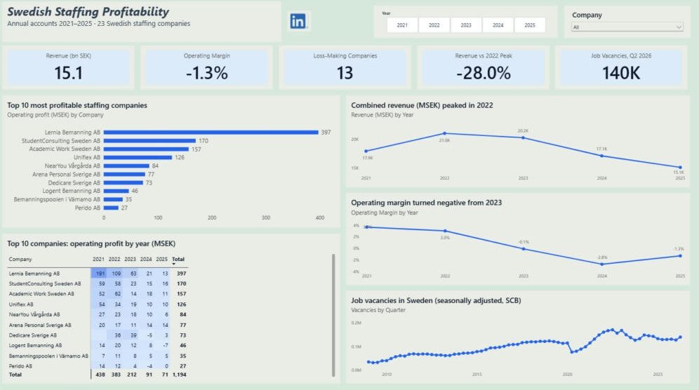

# Swedish Staffing Profitability

**Which Swedish staffing companies are actually profitable, and how has the industry held up as hiring demand cooled?**

A Power BI analysis of five years of annual accounts (2021–2025) for 23 Swedish staffing companies, set against national job-vacancy statistics from Statistics Sweden (SCB).



---

## Key findings

| | |
|---|---|
| **Revenue fell 28% from the peak** | Combined revenue dropped from 21.0 bn SEK in 2022 to 15.1 bn SEK in 2025. |
| **Margins turned negative** | The combined operating margin went from 3.7% (2021) to −0.1% (2023), −2.8% (2024) and −1.3% (2025). |
| **Most companies lost money in 2025** | 13 of the 23 companies made an operating loss. |
| **Size ≠ profit** | The biggest names by revenue (Randstad, Manpower, Adecco) made a combined operating loss over 2021–2025. |
| **Top 10 most profitable (operating profit 2021–2025)** | Lernia Bemanning 397 MSEK, StudentConsulting 170, Academic Work 157, Uniflex 126, NearYou Vårgårda 84, Arena Personal 77, Dedicare 73, Logent Bemanning 46, Bemanningspoolen i Värnamo 35, Perido 27. |
| **Profit pool shrinking fast** | The top 10 together earned 438 MSEK in 2021 but only 71 MSEK in 2025. |
| **Demand context** | Seasonally adjusted vacancies in Sweden peaked in 2022 and have stayed lower since, matching the revenue decline. |

---

## Data sources

| Dataset | Source | Coverage | Access |
|---|---|---|---|
| Company annual accounts | [allabolag.se](https://www.allabolag.se) company pages ("Bokslut"), based on annual reports filed with Bolagsverket | 23 companies × 2021–2025, kSEK | Collected per company, cleaned into [`data/staffing_financials_2021_2025.csv`](data/staffing_financials_2021_2025.csv) |
| Job vacancies | Statistics Sweden (SCB), Statistikdatabasen table **TAB6406** – *Lediga jobb, hela ekonomin, säsongrensad efter näringsgren SNI 2007* | Quarterly, 2009Q1–2026Q2 | Read live in Power Query from the SCB PxWebApi v2 (anonymous) |

Fields used from the annual accounts:

| Column | Swedish term | Meaning |
|---|---|---|
| `revenue_ksek` | Omsättning | Net revenue |
| `operating_result_ksek` | Rörelseresultat efter avskrivningar | Operating profit (EBIT) |
| `result_after_financial_items_ksek` | Resultat efter finansnetto | Profit after financial items |
| `net_result_ksek` | Årets resultat | Net profit for the year |

---

## Data collection and cleaning

1. **Choosing the companies.** I started from the large agencies (Randstad, Manpower, Adecco, Academic Work, StudentConsulting, Lernia and others) and widened the list with well-known general, IT, healthcare and student staffing firms. Each candidate was looked up on allabolag.se and kept only if its industry code is **NACE 78** (78100 recruitment / 78201 temporary staffing).
2. **Removing false matches.** Name searches sometimes hit unrelated companies (e.g. a paper wholesaler for "Hays AB"). These, plus holding companies (NACE 70100: Jobandtalent Sweden, Bemannia) and consultancy brokers outside NACE 78 (Ework Group), were excluded.
3. **Mapping the fields.** The four metrics above were mapped from the page data. I checked them against the published 2025 figures for Randstad and Manpower. That check caught one mapping error: an early version had operating profit and net profit swapped.
4. **Handling gaps and edge cases.**
   - **Poolia Sverige AB:** excluded. It reported zero activity in 2023–2024, which would distort averages.
   - **Dedicare Sverige AB 2021:** removed. There's no filed accounts for that year, so all values were 0.
   - **NearYou:** operates as several regional companies with no group-level accounts. *NearYou Vårgårda AB* is included under its legal name rather than presented as the whole group.
   - **2026:** not included. Financial years end on 31 December and reports are filed months later, so 2025 is the latest complete year.
5. **Why operating profit and not net profit?** Many of these firms are subsidiaries that transfer profit to their parent through group contributions and year-end appropriations. That pushes net profit towards zero (Lernia's net result is 0 every year), so **operating profit (rörelseresultat)** is the fairer measure of how profitable the business is.
6. **Vacancy data.** The SCB CSV is wide (one column per quarter), so Power Query unpivots it into rows. Cells marked `..` (not published) are removed, and quarter codes like `2026K2` are converted into dates. SCB doesn't publish the staffing-related industry group (M–N) in this seasonally adjusted series, so the dashboard uses the **all-industries** total.

Result: **114 rows** (23 companies; 5 years each except Dedicare with 4), values in kSEK.

---

## Data model

Two tables, deliberately **not related**. Company accounts and national vacancy statistics have no common key, so the vacancy chart shows market context.

```
FactFinancials  (Company, Year, Revenue, OperatingResult, ResultAfterFinancial, NetResult)   — kSEK
FactVacancies   (Industry, Quarter, QuarterStart, Vacancies)                                 — count
```

- Power Query scripts: [`powerquery/`](powerquery)
- DAX measures: [`dax/measures.dax`](dax/measures.dax)

Main measures: Revenue, Operating Result and Net Result in MSEK; Operating Margin; "selected year" versions for the KPI cards (latest year by default); Loss-Making Companies; Revenue Change vs 2022 (the revenue peak); Latest Vacancies.

---

## Dashboard design

- **Header:** title and scope, LinkedIn link, a Year tile slicer and a Company dropdown.
- **KPI row:** Revenue (bn SEK), Operating Margin, Loss-Making Companies, Revenue vs 2022 Peak, Job Vacancies (latest quarter).
- **Main visual:** *Top 10 most profitable staffing companies*. A bar chart with a visual-level **Top N filter** (top 10 by operating profit), so it re-ranks for the selected year.
- **Top 10 by year:** a matrix of company × year with a colour scale, sorted by five-year total.
- **Trends:** line charts for combined revenue, operating margin and quarterly vacancies.
- **Interactions:** the Year slicer filters the cards and the Top 10 bar. It's set to *None* on the trend lines and the matrix, so those always show the full 2021–2025 picture.

---

## Repository contents

```
├── Swedish_Staffing_Profitability.pbix   Power BI report
├── data/
│   └── staffing_financials_2021_2025.csv  cleaned company accounts (kSEK)
├── powerquery/
│   ├── FactFinancials.pq                  loads the CSV above
│   └── FactVacancies.pq                   live SCB PxWebApi query + reshaping
├── dax/
│   └── measures.dax                       all report measures
└── images/
    └── dashboard.jpg
```

## How to open

1. Install **Power BI Desktop** (free, Windows).
2. Open `Swedish_Staffing_Profitability.pbix`.
3. Click **Refresh** to pull the latest SCB vacancy data. If prompted, choose *Anonymous* access for statistikdatabasen.scb.se.

---

## Limitations

- These are the largest staffing firms I could identify and verify. It's not every company in the industry, so totals are for this group, not the whole industry.
- Annual accounts are legal-entity figures. Groups that spread staffing across several companies (e.g. Manpower, Experis, Manpower Flexjobb) appear as separate rows.
- Different financial-year ends and one-off items can affect year-to-year comparisons.
- The vacancy series is national (all industries), not staffing-specific.

---

**Author:** Chidinma Laura Ikwechegh, BI & Data Analyst, Stockholm
[Portfolio](https://laurascodes.github.io/Portfolio/) · [LinkedIn](https://www.linkedin.com/in/chidinma-laura-ikwechegh-4619a311b/)
